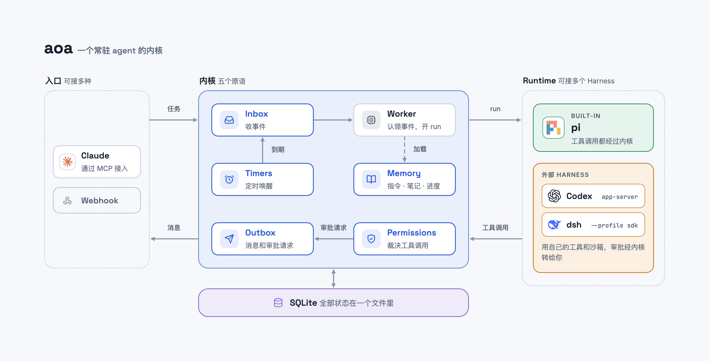
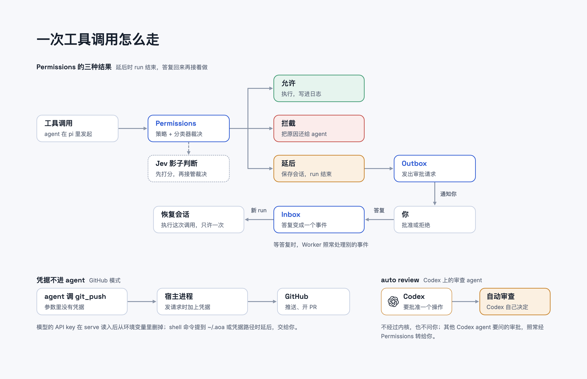
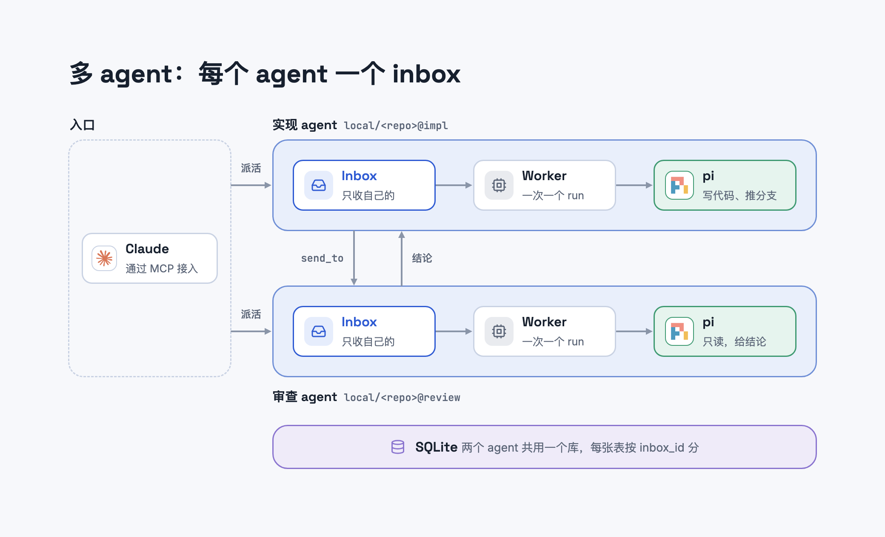

# aoa

[](LICENSE)


中文 · [English](README.en.md)

一个常驻的 agent 内核：你交代任务，它在自己的分支上做完，只在需要你的时候找你。

<picture>
  <source media="(prefers-color-scheme: dark)" srcset="docs/diagrams/architecture-dark.png">
  
</picture>

- **五个原语**都在内核里：Inbox 收事件，Timers 到点唤醒，Memory 跨 run 保留指令、笔记、进度和已发消息，Permissions 决定每次工具调用能不能做，Outbox 发消息并重试送达。所有状态都在一个 SQLite 文件里，进程崩溃后能接着做。
- **Worker** 认领一批事件，开一次 run 交给 runtime，再记下这次 run 的结局。
- **Runtime 分两类。** Built-in 的 pi 只有 aoa 给的工具，每次调用都由内核裁决和记录。外部 harness Codex、dsh 用它们自己的工具和沙箱，它们要问的审批会转给你；aoa 自己的工具仍然走内核。
- 你通过 CLI、MCP 或 GitHub issue 交代任务；本地模式的消息写进 `messages.md` 并弹桌面通知，GitHub 模式发在 issue 和 PR 上。

设计见 [docs/design.md](docs/design.md)，规范见 [docs/spec.md](docs/spec.md)。

状态：内核、SQLite 存储、三个 runtime（pi、Codex、dsh）、本地和 GitHub 通道、`aoa` 命令都已实现，aoa 在自己的仓库上用过（写代码、审查、合并）。dsh 还没在真机上跑过冒烟测试。

## 设计和实现

### 内核只认三个端口

内核不知道 GitHub、worktree 和具体模型，只认存储、runtime 和通道：

```ts
interface Store { tx<T>(fn: (t: Tx) => T): T }   // 一个事务 = 规范里的 ATOMIC
interface AgentRuntime { run(input: RunInput): Promise<RunResult> }
interface Channel {
  deliver(m: OutMsg): Promise<void>;
  poll(cursor: string | null): Promise<{ events: NewEvent[]; cursor: string }>;
}
```

- runtime 拿到的工具是内核包好的：`invoke` 里先裁决，再记日志，再执行，适配器绕不过去。pi 自带的 bash、read、edit、write 也被包成内核工具，pi 自己不直接执行任何工具。
- 一次 run 的结局只有三种：发了消息、没说话、停在一个延后的调用上。
- 「任务」不是内核概念。内核只有 session；`apps/aoa` 给新 session 建一个 worktree，一项任务就是一个 session 加一个 worktree。

### 一次工具调用

<picture>
  <source media="(prefers-color-scheme: dark)" srcset="docs/diagrams/tool-call-dark.png">
  
</picture>

- **裁决在模型之外**，依次是规则表、分类器、延后。只读工具和只读命令放行；`sudo`、强推、改 git 配置或远端、`curl | sh` 直接拦；规则判不了的交给分类器（一个小模型）；高风险和分类器拿不准的延后，未知工具默认延后。每次裁决连同依据写进日志。
- **目标是让专门的意图裁决模型来裁决。** 规则判不了的调用，最终交给 TypeSafe 的 Jev 这类专门判断意图的模型，不再靠通用小模型做分类器。现在处在第一步，影子阶段：配上 `shadowJudge`，分类器每被问一次，Jev 也在同一时刻判同一个调用，给出「不问你也能安全执行」的概率，但结论仍是分类器的，Jev 失败或 5 秒超时也不拖慢它。送给 Jev 的只有工具名、参数和 session 是否被外部内容污染，不带对话和记忆。分数存进 `judgments` 表，和分类器的结论、你的答复放在一起；下一步按这些数据给 Jev 定阈值，再让它接管裁决。模型钉在 `jev-1.14.0`，定阈值时不换版本。
- **延后不占着 worker。** session 存盘，run 结束，审批请求进 outbox。你的答复作为事件回到 inbox；新 run 开始前，内核自己执行被批准的那次调用，把结果交给 runtime，模型不会再调一次。同一个调用的第二次答复被去重，24 小时没答复就写一个到期事件。
- **只有你的话能批准。** 按作者判断，不按内容：issue 正文、别人的评论、另一个 agent 发来的消息都是外部内容，永远变不成审批答复。
- **凭据不进 agent。** GitHub 模式下 `git_push`、`github_open_pr`、`github_comment` 在宿主进程里执行，宿主加上凭据再发请求，agent 的上下文和参数里没有凭据。模型的 API key 在 `serve` 读入后从环境变量里删掉。aoa 不做沙箱：agent 的 shell 和宿主是同一个系统用户，所以碰 `~/.aoa` 或凭据路径的命令不会被直接放行，要问你。
- **auto review** 只用在 Codex 上的审查 agent：它的审批交给 Codex 自己的自动审查，不经过内核，也不问你。

### 崩溃后接着做

- 五个存储和辅助表都在一个 SQLite 文件里，规范里的 ATOMIC 就是一个事务：run 的结局、session 的更新和事件标完成一起提交。
- worker 的互斥靠数据库里的租约，不靠进程里的锁：claim 是一个事务，只有这个 inbox 没有未过期的租约时才成功。失败的一批事件 30 秒、2 分钟后重试，三次后停在 `dead`，`aoa status` 里看得到。
- 工具执行前先在 `tool_journal` 记下意图。恢复时遇到有意图、没结果的调用不重跑，而是把「结果未知，先查再决定」作为工具结果交回给 agent。
- 事件按 `(inbox, source, dedupe_key)` 去重；GitHub 轮询的游标和事件在同一个事务里存下，崩溃最多多轮询一次。outbox 送达失败按 1、2、4、8 分钟退避。

### 一致性测试

规范 §9 的 C1–C20 每条先写成失败的测试再实现，跑在带故障注入点的假 runtime 和假时钟上。每个提交点都有名字（`after_append`、`after_claim`、`after_tool_exec`、`after_tool_result`、`before_complete`），测试在这些位置杀进程再恢复。

## 快速开始

1. 装 [Bun](https://bun.sh)。在仓库根目录运行 `bun install`，再在 `apps/aoa` 下运行 `bun link`，之后 `aoa` 在任何目录都能用。
2. 把 `aoa.config.example.ts` 复制成 `~/.aoa/aoa.config.ts`，填上仓库路径和模型。配置里只写环境变量名，不写密钥；按 `--config`、当前目录的 `aoa.config.ts`、`~/.aoa/aoa.config.ts` 的顺序找。
3. 跑在 pi 上的 agent 需要一个 `classifier` 模型：没有它，每条 `bash` 都要等你批准，agent 既跑不了检查也提交不了。
4. 启动，然后派活：

```bash
aoa serve                       # 常驻；Ctrl-C 停
aoa send "修掉 README 的错字"   # 开一个任务，输出它的线程，如 local:1a2b3c4d
```

没有 `github` 一段就是本地模式：不用 GitHub，不推送，不开 PR。

## 命令

| 命令 | 作用 |
|---|---|
| `aoa serve` | 常驻运行 |
| `aoa send "<文字>"` | 开一个任务 |
| `aoa send --agent <名字> [--branch <分支>] "<文字>"` | 给具名 agent 派活；`--branch` 指定审查 agent 要审的分支 |
| `aoa send --to <线程或前缀> "<文字>"` | 接着某个任务说；任务在等回答时，`/approve` 是批准，其他内容算拒绝和理由 |
| `aoa answer <调用 id 或前缀> approve\|deny [理由]` | 回答等你决定的调用 |
| `aoa close <线程或会话前缀> merged\|discarded` | 本地模式：告诉 aoa 分支的结局 |
| `aoa messages [--since <游标>] [--wait <秒>] [--json]` | agent 说过的话，末尾是新游标 |
| `aoa status [--json] [--refresh]` | 任务、结局、待审批、死信、失败的消息、每个 agent 的 runtime |
| `aoa mcp` | 把 send、messages、status、close、answer 作为 stdio 上的 MCP 工具 |

## 一个任务怎么走（本地模式）

- 每个任务在 `<dataDir>/worktrees/` 下有自己的 worktree，提交在本地分支 `aoa/<会话 id 前 8 位>` 上。
- agent 找你时，消息追加到 `<dataDir>/messages.md`，macOS 上同时弹通知。要你批准时，消息里写着对应的 `aoa answer` 命令。
- 你自己看分支、合并，然后用 `aoa close` 告诉 aoa 结局。`close` 只做记录；`serve` 在下一次检查（5 秒内）关掉任务、删掉 worktree，分支保留。
- `bash` 里出现 `git push` 时会先问你。这只是约定，不是隔离：agent 的 shell 就是你的 shell。

## 多个 agent：实现加审查

在配置里加 `agents`，就能让几个具名 agent 跑在同一个 `serve` 里。顶层字段就是默认 agent；每个具名 agent 有自己的 inbox、worker、角色、权限和记忆，没写的字段（`model`、`classifier`、`risk`）沿用顶层。

<picture>
  <source media="(prefers-color-scheme: dark)" srcset="docs/diagrams/multi-agent-dark.png">
  
</picture>

每个 agent 一个 inbox、一个 worker：一个 inbox 同时只有一个 run，不同 agent 的 run 可以同时跑。agent 之间只通过往对方的 inbox 写事件合作，所有 agent 共用一个库和一个时钟。

- `implement`（默认）：写代码。
- `review`：只读。没有 edit、write，改引用或改历史的 git 命令一律拦掉。

```ts
agents: {
  reviewer: { role: "review", instructions: "Focus on missing tests." },
},
```

有审查 agent 时，实现 agent 提交后用 `send_to` 把分支交给它。审查 agent 在一个停在那个提交上的独立 worktree 里检查能否干净合并、跑测试、确认新测试去掉修复后会失败，然后把结论发回实现 agent，同时通知你。结论只是建议，合并、关任务、回答审批都由你来。两个 agent 之间来回最多 4 条消息，再多就会转来找你。

具名 agent 的 inbox 是 `local/<repo>@<名字>`，记忆和 worktree 在 `memory/local/<repo>@<名字>/`、`worktrees/local/<repo>@<名字>/` 下，分支是 `aoa/<名字>/<会话 id 前 8 位>`。`status`、`messages`、`answer`、`send --to`、`close` 会在所有 agent 里找。只能用在本地模式。

## Runtime：pi、Codex、dsh

每个 agent（顶层或具名）用 `runtime` 选一个，默认是 `pi`。

| | pi | Codex | dsh（DeepSeek Harness） |
|---|---|---|---|
| 类型 | Built-in | 外部 harness | 外部 harness |
| 谁决定工具调用 | aoa 决定每一次 | Codex 的审批和沙箱设置，它要问的转给你 | `dsh.preset` 定的沙箱和审批，它要问的转给你 |
| 怎么接 | 进程内的 pi 会话 | 每次 run 起一个 `codex app-server` | 每次 run 起一个 `dsh --profile sdk` |
| aoa 自己的工具 | 直接给 pi | 动态工具 | 只监听 127.0.0.1 的 MCP 桥 |
| 认证 | `model.apiKeyEnv` | Codex 自己的登录，aoa 不碰 | `apiKeyEnv`，只传给 dsh 子进程 |
| 审查角色 | 支持，aoa 的只读规则生效 | 支持，跑在 Codex 的 auto review 模式里 | 不支持 |
| 模式 | 本地和 GitHub | 只能本地 | 只能本地 |

```ts
agents: {
  coder: { runtime: "codex", model: "your-codex-model-id" },             // model 可省，用 Codex 的默认模型
  deepseek: { runtime: "dsh", model: "deepseek-flash", apiKeyEnv: "DEEPSEEK_API_KEY" },
},
```

两个外部 harness 的共同点：
- 它们要问的审批会变成 aoa 的审批请求；你批准后，它们再做一次同样的操作，这次直接放行，许可只用一次。
- 它们不问就能做的事，aoa 看不到，也拦不住。aoa 的推送规则、`~/.aoa` 规则和 worktree 边界对它们自己的工具不起作用；`serve` 启动时会为每个这样的 agent 提醒一次。

**Codex**
- 你的 Codex 审批和沙箱设置照用。
- 你在 Codex 里装的插件、MCP server 和 hooks 不会带进来，aoa 启动 Codex 时全部关掉。
- 审查角色跑在 Codex 的 auto review 模式里（workspace-write 沙箱，审批交给 Codex 自己的自动审查，不会来问你）。它能不能提交，靠的是 Codex 的审查和提示，不是硬性限制。

**dsh**
- aoa 给它一个独立的 home（`<dataDir>/dsh-home`），每次 run 写一个 patch：写入权限预设，关掉 dsh 自己的子代理、team、goal、workflow、jobs、插件管理，以及它自己的提问和定时工具。
- `dsh.preset` 默认 `workspace-write`，可选 `read-only`、`danger-full-access`。改了预设，已经开始的任务在下一次 run 前也会切过去。
- 启动前会检查 `dsh --version`，不是测试过的 `0.2.2-rc.3` 就不跑。dsh 还在开发者预览阶段，换版本可能要跟着改 patch 和版本常量。

## 让聊天里的 agent 当入口

aoa 自己没有主会话。你在别的聊天 agent（比如 Claude Code）里说话，让它敲命令就行：

```bash
aoa send "..."                           # 派活，记下输出的线程
aoa messages --since <游标> --wait 600    # 等下一条消息；输出末尾是新游标
aoa answer <调用 id> approve|deny [理由]   # 消息是审批请求时
```

`messages` 读的是 outbox，不是 `messages.md`，所以两种模式都能用；加 `--json` 方便程序读。

会说 MCP 的 harness 不用敲命令。`aoa mcp` 提供同样的五个工具，读写同一份配置和库，不需要 `serve` 在跑。在 Claude Code 里注册一次：

```bash
claude mcp add aoa -- aoa mcp
```

约定：审批留给你。聊天 agent 只转述请求，你明确同意或拒绝之后才调用 `answer`。通过 MCP 时，`send` 不能拿来回答等审批的任务。

## 接 GitHub（可选）

在配置里加 `github` 一段（示例见 `aoa.config.example.ts`）。再建一个 GitHub App 装到目标仓库，给 Issues、Pull requests、Contents 的读写权限，私钥文件放在本机。

之后：
- `send` 会开一个带标签的 issue；agent 推送分支、开 PR，并在 issue 上评论。
- 在评论里回复 `/approve` 或 `/deny 理由`。
- PR 合并或关闭，任务就结束，`aoa close` 不可用；`status --refresh` 会先去 GitHub 查 PR 状态。

## 开发

Bun + TypeScript 的 monorepo。

| 包 | 作用 |
|---|---|
| `packages/kernel` | 五个原语、worker、策略、调度，不依赖存储和模型 |
| `packages/store-sqlite` | SQLite 存储和迁移 |
| `packages/runtime-pi` · `runtime-codex` · `runtime-dsh` | 三个 runtime 适配器 |
| `packages/channel-local` · `channel-github` | 本地和 GitHub 通道 |
| `packages/conformance` | 规范 §9 的 C1–C20 一致性测试 |
| `apps/aoa` | `aoa` 命令：配置、接线、serve、MCP |

```bash
bun test               # 全部测试，不调用真实模型
bun run typecheck
bun scripts/diagrams/build.ts   # 从 docs/diagrams/boards 重新生成 README 里的图（需要 Chrome）
AOA_CODEX_SMOKE=1 bun test packages/runtime-codex/test/smoke.test.ts   # 真实 Codex，会消耗额度
AOA_DSH_SMOKE=1 bun test packages/runtime-dsh/test/smoke.test.ts       # 真实 dsh 和 DeepSeek key
```
