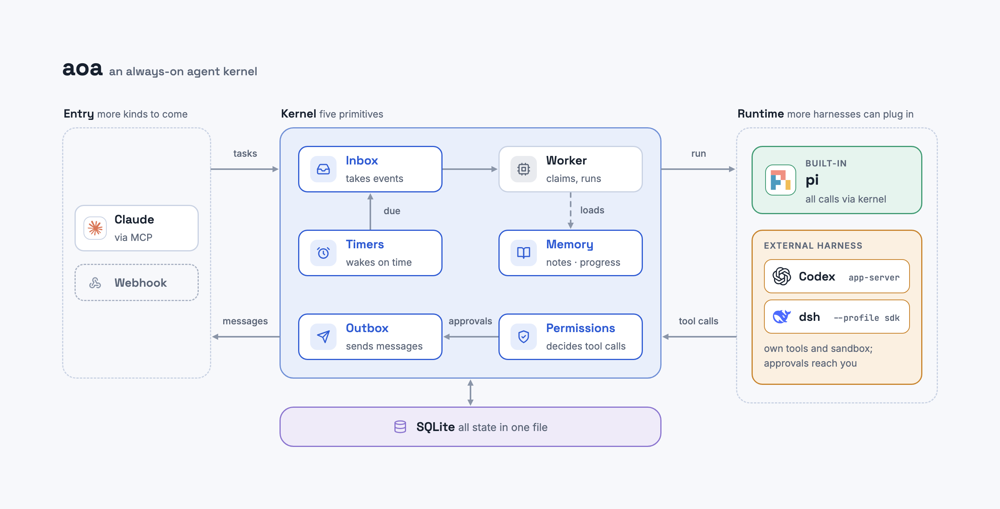
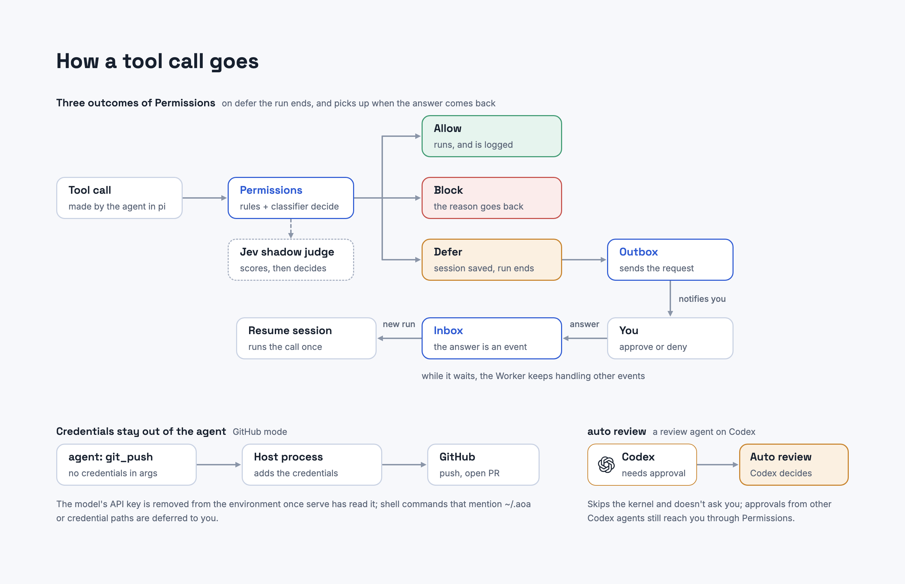
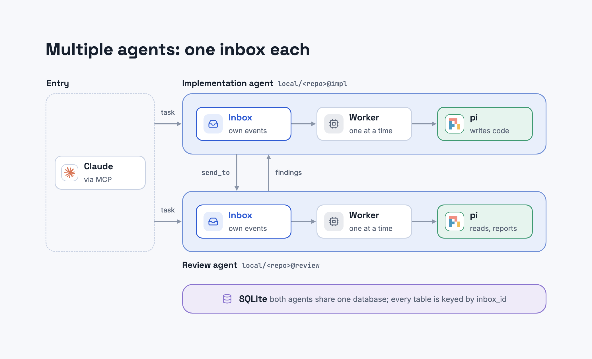

# The aoa command

[中文](README.md) · English

A coding agent built on [`@aoa-dev/sdk`](../../README.en.md) that runs 24x7. You hand it a task, it finishes the work on its own branch, and it only comes to you when it needs you. It is also the fullest example of using the SDK: config, wiring, channels and the observation page live in this package, and it reaches the kernel only through the SDK.

<picture>
  <source media="(prefers-color-scheme: dark)" srcset="../../docs/diagrams/architecture-en-dark.png">
  
</picture>

You hand out tasks through the CLI, MCP or a GitHub issue. In local mode, messages are appended to `messages.md` with a desktop notification; in GitHub mode they are posted on the issue and the PR.

## Quick start

```bash
# Install
curl -fsSL https://bun.sh/install | bash
git clone https://github.com/bubbleptr/aoa.git && cd aoa
bun install
(cd apps/aoa && bun link)

# Configure: set repo.path; DeepSeek is the default
mkdir -p ~/.aoa
cp aoa.config.example.ts ~/.aoa/aoa.config.ts
$EDITOR ~/.aoa/aoa.config.ts
export DEEPSEEK_API_KEY=<your key>

# Start
aoa serve
```

In another terminal:

```bash
aoa send "Fix the typo in README"    # hand out work; prints the thread, e.g. local:1a2b3c4d
aoa messages                         # what the agent has said
aoa answer <call id> approve         # when it asks for approval
aoa status                           # tasks and pending approvals
aoa close local:1a2b3c4d merged      # after you've reviewed and merged the branch

claude mcp add aoa -- aoa mcp        # optional: use it straight from Claude Code
```

## Commands

| Command | What it does |
|---|---|
| `aoa serve` | Stays running |
| `aoa send "<text>"` | Opens a task |
| `aoa send --agent <name> [--branch <branch>] "<text>"` | Hands work to a named agent; `--branch` names the branch a review agent should review |
| `aoa send --to <thread or prefix> "<text>"` | Continues a task; while it waits for an answer, `/approve` approves and anything else is a denial with reasons |
| `aoa answer <call id or prefix> approve\|deny [reason]` | Answers a call that is waiting on you |
| `aoa close <thread or session prefix> merged\|discarded` | Local mode: tells aoa how the branch ended |
| `aoa messages [--since <cursor>] [--wait <seconds>] [--json]` | What the agents have said, ending with a new cursor |
| `aoa status [--json] [--refresh]` | Tasks, outcomes, pending approvals, dead letters, failed messages, and each agent's runtime |
| `aoa mcp` | Exposes send, messages, status, close and answer as MCP tools over stdio |

## A tool call

<picture>
  <source media="(prefers-color-scheme: dark)" srcset="../../docs/diagrams/tool-call-en-dark.png">
  
</picture>

- **The agent makes most decisions itself.** Every tool call first goes through a rule table: read-only calls are allowed, and things like `sudo`, force pushes and `curl | sh` are blocked. Everything else goes to a classifier, the same idea as auto mode in Claude Code. Today the classifier is a small model, and the intent model Jev scores the same calls alongside it; once there is enough data, Jev takes over. So most calls never wait for a person, and the agent keeps running.
- **When it needs you, it uses a deferred tool call.** For calls that are high-risk or that the classifier is unsure about, the kernel saves the session, ends the run and sends you an approval request; once your answer comes back, it runs that one call exactly once (see [permissions in the SDK](../../README.en.md#permissions)).
- **Credentials are added by a proxy.** `git_push`, opening PRs and posting comments run in aoa's host process, which adds the GitHub credentials, so the agent never sees them.

## Multiple agents: implement plus review

Add `agents` to the config to run several named agents in the same `serve`. The top-level fields are the default agent; each named agent has its own inbox, worker, role, permissions and memory, and fields it leaves out (`model`, `classifier`, `risk`) come from the top level.

<picture>
  <source media="(prefers-color-scheme: dark)" srcset="../../docs/diagrams/multi-agent-en-dark.png">
  
</picture>

- `implement` (default): writes code.
- `review`: read-only. No edit or write, and git commands that move refs or rewrite history are blocked.

```ts
agents: {
  reviewer: { role: "review", instructions: "Focus on missing tests." },
},
```

With a review agent configured, the implementation agent hands its branch over with `send_to` after committing. In a separate worktree pinned to that commit, the review agent checks that it merges cleanly, runs the tests, and confirms that new tests fail with the fix removed, then sends its findings back to the implementation agent and notifies you. The findings are advice only: merging, closing the task and answering approvals stay with you. The two agents exchange at most 4 messages before the thread is turned over to you.

## How a task goes (local mode)

- Each task gets its own worktree under `<dataDir>/worktrees/` and commits to the local branch `aoa/<first 8 characters of the session id>`.
- When the agent needs you, the message is appended to `<dataDir>/messages.md`, with a notification on macOS. When it needs approval, the message includes the matching `aoa answer` command; you can also open the page (the address `serve` prints, `http://127.0.0.1:7878` by default), read the whole call under Permissions and click Approve or Deny there, or type the answer to a question. Click "Notify me when it waits for me" on the page and allow notifications: while the page is open, each call waiting for you raises a browser notification that opens its answer box, and approval requests no longer raise the macOS notification.
- You review and merge the branch yourself, then tell aoa the outcome with `aoa close`. `close` only records it; at its next check (within 5 seconds) `serve` closes the task and removes the worktree, keeping the branch.
- Events that failed three times and stopped show up in `aoa status`.
- A `git push` inside `bash` asks you first. This is a convention, not isolation: the agent's shell is your shell.

## A chat agent as the entry point

aoa has no main session of its own. Talk to another chat agent (Claude Code, say); it hands out work, waits for messages and relays approvals through `aoa mcp`. Register it once:

```bash
claude mcp add aoa -- aoa mcp
```

`aoa mcp` offers five tools, `send`, `messages`, `status`, `close` and `answer`, reads and writes the same config and database, and does not need `serve` running. When the client supports MCP 2026-07-28 Tasks (Claude Code 2.1.332 and later), `messages` with `wait` no longer waits two minutes at most: it returns a task the client polls, which completes when there is something new. When the client can also show forms, an approval or question waiting for you is asked of you directly as a form: approve or deny an approval, with an optional reason, or type the answer to a question. If you decline the form, the call keeps waiting and the wait ends with it, so you can still answer it elsewhere.

Convention: approvals belong to you. In clients that cannot show forms, the chat agent only relays the request and calls `answer` after you have clearly approved or denied. Over MCP, `send` cannot be used to answer a task that is waiting for approval.

Harnesses that don't speak MCP can run the commands instead:

```bash
aoa send "..."                           # hand out work and note the printed thread
aoa messages --since <cursor> --wait 600  # wait for the next message; the output ends with a new cursor
aoa answer <call id> approve|deny [reason]  # when the message is an approval request
```

`messages` reads the outbox, not `messages.md`, so it works in both modes; add `--json` for programs.

## Connecting GitHub (optional)

Add a `github` section to the config (see [`aoa.config.example.ts`](../../aoa.config.example.ts)). Then create a GitHub App, install it on the target repository with read and write access to Issues, Pull requests and Contents, and keep the private key file on your machine.

After that:
- `send` opens a labeled issue; the agent pushes a branch, opens a PR and comments on the issue.
- Reply `/approve` or `/deny reason` in a comment.
- When the PR is merged or closed the task ends, and `aoa close` is not available; `status --refresh` checks the PR state on GitHub first.

## Development

```bash
bun test apps/aoa
```
